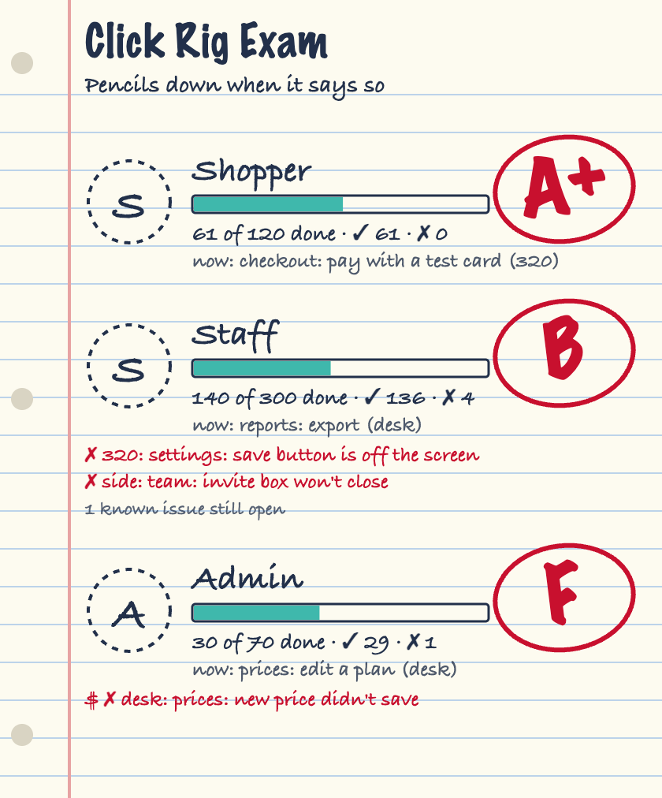

# Click Rig

Your browser tests, graded like a 1980s paper exam. A sheet of notebook paper sits beside the chat in Claude Code, showing each test track's progress, its errors in red, and a letter grade in red marker.



The mod doesn't run tests. Your test rig writes one small JSON file as it goes, in any language, and the sheet draws it.

## Install

At a Claude Code terminal prompt:

```
/plugin install click-rig --marketplace 1upcreative/click-rig
```

Answer `y` to add the marketplace, then pick a scope.

From a shell:

```bash
claude plugin install click-rig --marketplace 1upcreative/click-rig
```

In the desktop app, click + next to the prompt box, then Plugins, Add marketplace with `1upcreative/click-rig`, then Add plugin.

## Try it

Copy the sample run into place, then type `/clickrig`:

```bash
mkdir -p ~/.claude/clickrig && curl -o ~/.claude/clickrig/live.json https://raw.githubusercontent.com/1upcreative/click-rig/main/docs/sample-live.json
```

## Feed it from your rig

While it runs, your rig writes `~/.claude/clickrig/live.json`. Write the whole file each time, to a temp name, then rename it, so the sheet never reads half a file. The sheet checks once a second. It opens when a new run starts and shows a toast with the grades when the run ends.

```json
{
  "state": "running",
  "startedAt": "2026-01-05T15:00:00.000Z",
  "updatedAt": "2026-01-05T15:06:00.000Z",
  "tracks": {
    "shopper": {
      "name": "Shopper",
      "done": 61,
      "total": 120,
      "passes": 61,
      "fails": 0,
      "skips": 0,
      "now": { "size": "phone", "step": "checkout: pay with a test card" },
      "grade": "A+",
      "score": 100,
      "why": "61 of 61 steps passed.",
      "problems": [
        { "status": "FAIL", "money": true, "size": "phone", "step": "checkout: total was wrong", "detail": "" }
      ],
      "known": [],
      "lastPasses": []
    }
  }
}
```

- `state` is `running` or `done`. When it's done, add `"pass": true` or `false`.
- `startedAt` tells one run from the next. Change it each run.
- `total` can be `null` on a first run, when you don't know it yet.
- `size` is `desktop`, `phone`, `landscape`, or any word of your own.
- `problems` holds steps with the status `FAIL` or `SKIP`. `money: true` marks a line with a `$`.
- `grade` is yours to give. A `?` draws gray with no circle. The mod never works out a grade, so your rig's rules stay in your rig.

A fair rule to start from: any failed money check is an automatic F, so a pretty grade can't hide a bug.

## Faces

Each track can wear a picture. Put a PNG at `~/.claude/clickrig/art/approved/<track>.png`, named after the track's key in the feed (`shopper.png`). Pixel art looks best at about 192 by 216. With no picture, the sheet draws the track's first initial.

## License

MIT
